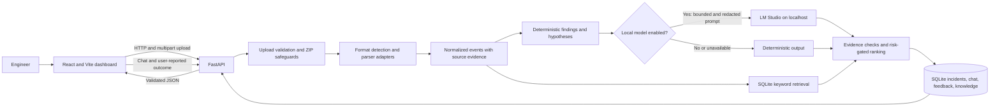
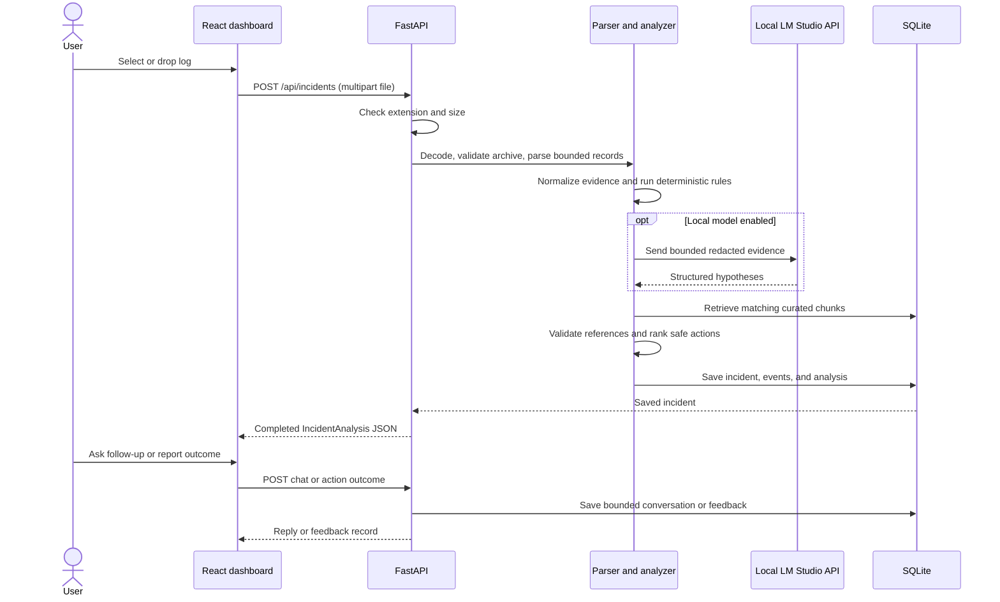

# Architecture

InfraGuide AI is a local-first log analysis prototype. The browser communicates with FastAPI; analysis, chat history, feedback, and curated document chunks are stored in SQLite. Optional language-model calls go to the configured LM Studio server on the same PC. The app does not use hosted model APIs.

## Components

## Upload and analysis sequence

## Runtime behavior

- `POST /api/incidents` performs analysis synchronously. The request does not return an accepted/background job state.
- The parser supports `.log`, `.txt`, `.csv`, `.json`, and `.zip` of supported files. EVTX is rejected because an EVTX parser is not installed.
- Text records are bounded to 10,000 per file; ZIP processing is bounded by archive entry count, unpacked bytes, and 30,000 aggregate events. Limits are implementation details and may be tightened.
- Findings from supported parsers and rules are deterministic. If enabled, LM Studio may add evidence-linked hypotheses. Invalid or unavailable model output leaves deterministic results in place.
- Recommendations pass evidence-reference checks and a separate risk gate. The gate permits only `read_only` and `reversible` action categories. No infrastructure commands are executed.
- Documentation ingestion stores permitted text and metadata in SQLite. Retrieval is local keyword matching, not vector search or web crawling. A source is shown only when it was indexed, matched, and passed the configured trusted-domain check.
- Chat history is bounded in SQLite. Action outcomes are user feedback, not verified ground truth.

## Local model and privacy boundary

The example configuration uses `http://127.0.0.1:1235/v1` and `ministral-3-8b-instruct-2512`; verify the served model ID through LM Studio's `/v1/models` endpoint. The backend rejects non-local model hosts, disables environment proxy use for model requests, and uses a request timeout. With `LOCAL_MODEL_ENABLED=false`, no model request is made.

Before optional model analysis, selected event messages are redacted for common credential and email patterns. Redaction is best-effort, not a guarantee. Treat logs, retrieved documents, and user text as untrusted. Do not submit confidential production logs until deployment and data-handling controls are approved.

## Persistence

SQLite stores incidents and their analysis, conversations, action feedback, and curated-document chunks. `DATABASE_PATH` is resolved relative to the backend process working directory when relative. The local launch command runs from `backend/`; choose a path appropriate to that working directory. Compose sets its database path to `/data/infraguide.db` in a persistent volume. Database files are application state, not synthetic fixtures, and should not be used as documentation examples.