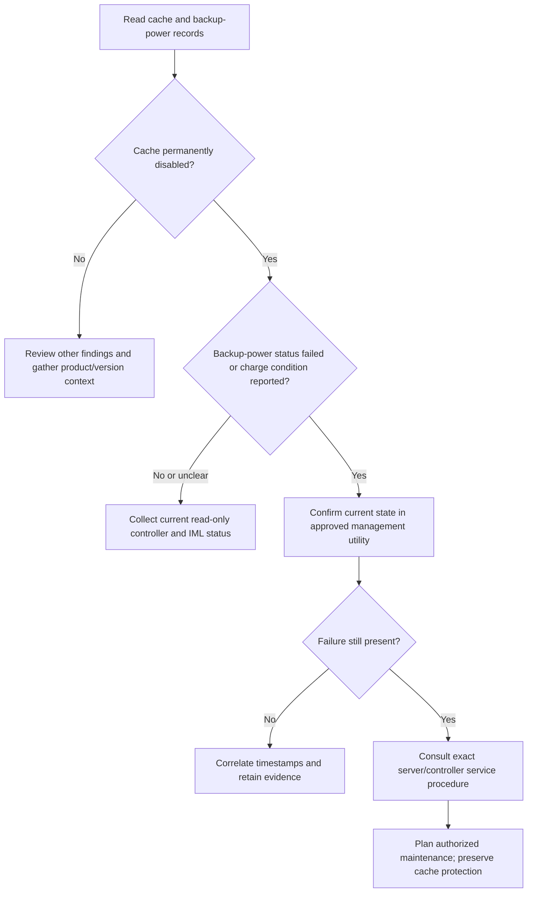

# HPE Smart Array Cache Troubleshooting

This guide documents the behavior of the deterministic HPE Smart Array rule using the sanitized fixture `samples/synthetic_hpe_smart_array.log`. It does not reproduce the supplied production log or its serial numbers.

## Reported signal

The rule recognizes the Smart Array controller report and flags the protected write-cache state when it contains signals such as:

- `Cache Status: Permanently Disabled`
- `Cache Status Details` reporting that the backup power source failed to charge
- `Cache Disable Reason` describing the failed charge condition
- `Battery/Capacitor Status` reporting a failed backup-power component

Each finding links to the parsed source records, including source file and line number. The parser classifies these semantic hardware failure records as error-level even when the text does not contain the literal word `ERROR`.

## Facts and interpretation

**Observed in the sample:** the report says protected write cache is permanently disabled; its details report an unacceptable backup-power charge; the backup-power status is failed. The report also lists the controller and shown drives as `OK`.

**Supported interpretation:** a cache backup-power subsystem issue is consistent with the reported cache disablement.

**Not established by this excerpt:** the physical component root cause, whether a connector or controller condition contributes, whether the current state has changed since capture, disk failure, or data loss. Do not present a likely cause as a confirmed hardware diagnosis.

## Read-only investigation

1. Confirm the server model, controller, firmware, operating system, and HPE storage driver. The excerpt alone may not identify the exact supported service procedure.
2. Through an approved, read-only HPE management utility, check whether the cache and capacitor/battery alerts are still present. Compare current status with recent Integrated Management Log entries.
3. Record controller, cache module, logical-drive, physical-drive, and time details for the service case. Preserve the original report under the organization's log-handling controls.
4. If the fault persists, consult the server- and controller-specific vendor service documentation and plan any physical work through the approved maintenance process.

Do not force-enable write-back cache, bypass backup-power protection, or issue controller modification commands as a diagnostic shortcut. Hardware inspection or replacement requires the exact supported procedure and authorization.

## Information that narrows diagnosis

- Exact server and controller model, firmware, and installed storage driver version.
- Capture time, time zone, and whether the report is current.
- Current iLO/IML and management-utility alerts.
- Recent hardware changes, maintenance, or related controller events.

This is troubleshooting guidance, not a vendor service bulletin. Verify model-specific instructions with authoritative HPE documentation before hardware work.